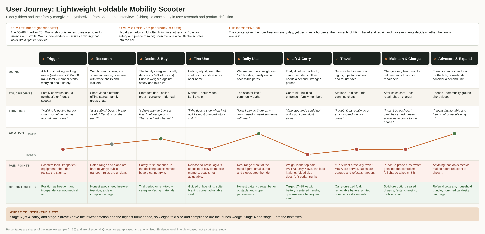

# User Journey: Lightweight Foldable Mobility Scooter

A journey map for elderly riders and their family caregivers, synthesized from **36 in-depth interviews** (phone calls, 7–15 minutes each, China, summer 2026). It was one input to a product-definition review for a lightweight, foldable mobility scooter.

Vector version: [`lightweight-scooter-user-journey.svg`](lightweight-scooter-user-journey.svg)

## My role

Independent owner of the research: interview design, running the interviews, transcript verification, coding, synthesis, and turning the findings into product-definition inputs (requirements and priorities).

## Method

1. Recruited from a beta-tester sign-up pool; riders aged 55–88 (median 76). About 74% of purchases were decided by an adult child or other family member, so caregivers were interviewed as decision makers, not only riders.
2. Every call was transcribed and checked line by line against the intake sheet (identity, city, device, decision maker).
3. Each interview became a one-to-two-page profile: persona, purchase decision, usage scenes, pain points, expectations, verbatim quotes.
4. Quotes and pain points were coded, then clustered by the stage of the journey where they occur.
5. Pain points were ranked by how many people raised them and at which stage, then translated into design implications.

## What the map shows

| Finding | Evidence | Implication |
|---|---|---|
| Daily riding is the happiest part of the journey, and lifting is the lowest point. | Weight was raised by about 74% of interviewees; only about 15% could load the scooter alone. | Make weight and fold size the launch wedge, not an afterthought. |
| Travel is the biggest unmet need. | About 57% wanted cross-city trips by rail or air; about 15% were served. Rules were unclear and refusals happened. | Design the fold size, removable battery and compliance documents together. |
| Safety trust decides the purchase more than price. | Several caregivers only agreed after the rider tried it. | Offer a trial period and caregiver-facing materials. |
| “Lighter” must not mean “less useful”. | Riders asked first whether the basket still existed, and one reported weaker climbing after a lighter version. | Treat basket, grab position and climbing ability as red lines when cutting weight. |
| Design weight for the real lifter. | The person who lifts is often a daughter or daughter-in-law, not the strongest family member. | Set the weight target from the caregiver's strength, not the average adult's. |
| Looking medical is a hidden barrier. | Riders refused devices that look like wheelchairs. | Use a non-medical design language. |

## Design implications (summary)

- **Must:** about 17–18 kg including battery (up to 20 kg acceptable); folds to fit a sedan trunk; sealed chassis; anti-loosening fasteners; adjustable braking.
- **Should:** one-person one-step fold; centered carry handle; quick-release battery and seat (some users already do this by hand); keep basket and cane holder; accurate battery gauge.
- **Nice to have:** wheels for pushing the folded unit; rent-to-own or trial; compliance documents for rail and air.

## Limitations

Interview-based and directional, not a statistical study. The sample came from a beta sign-up pool, so it skews toward engaged users. Percentages are shares of the interview sample (n=36).

## Anonymization

Names, cities, company, product and model names are removed. Quotes are paraphrased. The persona is a composite.
