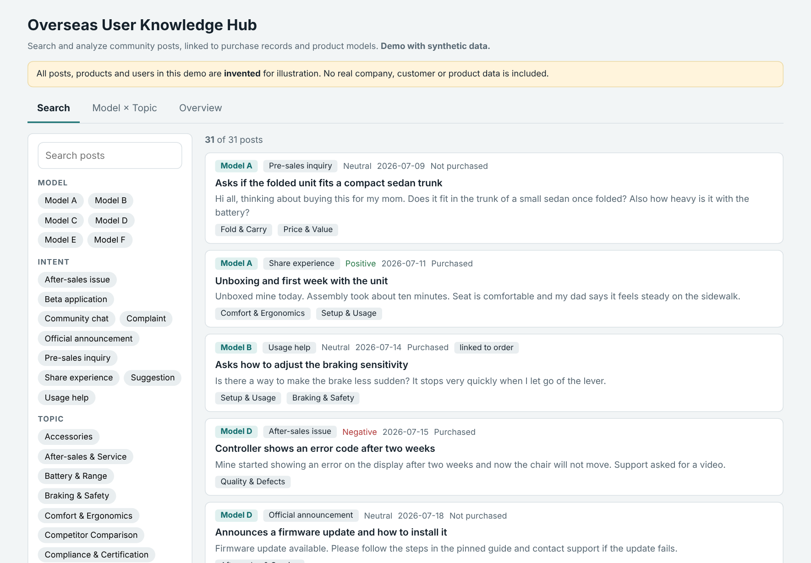

# Overseas User Knowledge Hub

An internal web tool that connects what overseas users say in a community group, what they bought, and which product they use, so the product team can search the voice of the customer instead of scrolling through chat.

> **Confidentiality note.** This is a sanitized portfolio version. Company, product, model and user identifiers are removed. The demo and the sample data are **synthetic**. The numbers below are rounded and aggregated.

**Live demo (synthetic data):** open [`demo/index.html`](demo/index.html) in a browser, or enable GitHub Pages for this folder.

## The problem

A hardware company sold mobility products to overseas customers. Feedback arrived in three places that never met: posts in a community group, e-commerce orders, and support emails. Questions like “what do users of this model complain about most?” or “why did this person buy it and how do they use it?” took a day of manual digging, and the answers were not reusable.

## What I built

I owned this as product manager and analyst, from the first sketch to deployment on the company's internal server.

| View | What it answers |
|---|---|
| **Search** | Full text and filters over community posts (original and translation): by model, intent, topic, sentiment, purchase stage. |
| **Model × Topic** | A heat map of what each product is talked about for. Click a cell to read the actual posts. |
| **User trajectory** | Pick one user: why they bought, what they bought, how they use it, how their feedback changed over time. |
| **Overview** | Distribution of intents, topics and sentiment for any filtered slice. |
| **Natural-language Q&A** | Ask a question in plain language and get an answer with links to the supporting posts. |

## How it works

1. **Collect:** community posts, e-commerce orders, support tickets and group-join forms are imported on a schedule.
2. **Match:** posts are matched to orders by username first, then confirmed by hand when names collide. Email data upgrades the match from a name to a customer.
3. **Label:** each post gets an intent (10 types), topic tags (14 topics), sentiment, purchase stage and a product model, using a unified scheme. Model assignment carries a confidence level, so “inferred” labels are shown as such.
4. **Serve:** an internal web app with search, filters, heat map, user trajectory and Q&A. Access is limited to the company network.
5. **Improve:** a sample of labels is spot-checked and the rules are corrected; only new posts are labeled on each refresh.

Details: [`PRD.md`](PRD.md) · [`docs/data-model.md`](docs/data-model.md) · [`sample-data/posts_sample.csv`](sample-data/posts_sample.csv)

## Scale (rounded)

- 600+ community posts, 500+ from users
- 1,700+ support tickets
- 1,000+ community join forms
- 14 topic tags, 10 intent types, 6+ product models

## What it found (examples)

- One flagship model produced about **37% of the posts but only about 11% of the orders**: the group's voice leans toward that product, so volume alone overstates its issues. The tool shows both.
- The most concentrated problem cluster for that model was a single **controller / joystick fault**, which turned a vague “quality” complaint into a specific engineering ticket.
- Only about **one in five posts could be matched to an order**, and most matches were “bought first, posted later”, which changed how we read pre-sales questions.
- The three biggest topics were use-case needs, trial and purchase questions, and accessories: input for product selection and the accessory roadmap.

## Decisions and trade-offs

- **MVP on a small slice first.** I built the search and the heat map on posts and orders before touching support email, so the team could react to something real within days.
- **Posts only, not comments, at first.** Comment scraping was fragile, so the “solutions” side stayed incomplete until support-email replies could be structured.
- **Match by name, flag the risk.** Names can collide, so matches were shown with their source and were reviewed manually.
- **Privacy by design.** Personal data stays on the internal server; a masked version is planned for wider sharing.

## My role and skills

Product definition, requirements, data model and labeling scheme, matching logic, QA process, dashboard design, stakeholder alignment, and running the deployment with IT. Tools: Python, SQL, LLM-assisted labeling and Q&A, HTML/JS front end.
